# Containerized Microservices with ECS Fargate and Service Discovery

AWS Solutions Architect – Associate graduation project (Project 6).

A monolithic Node.js application is split into three microservices — **Auth**, **Orders** and **Notifications** — running on **Amazon ECS Fargate**. Services find each other through **AWS Cloud Map** DNS, external traffic enters through an **Application Load Balancer** with path-based routing, secrets are injected at runtime from **AWS Secrets Manager**, sessions are shared through **ElastiCache Redis**, and requests are traced with **AWS X-Ray**. The whole infrastructure is defined in **Terraform**.

## Solution architecture

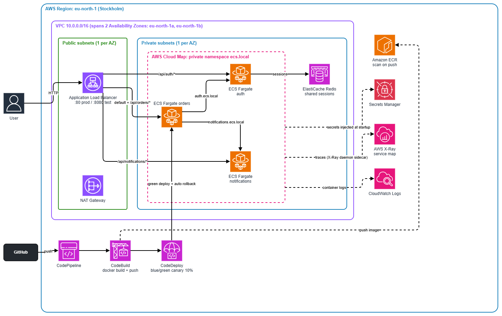

The bottom row (GitHub → CodePipeline → CodeBuild → CodeDeploy) is the **target CI/CD design** described in [Next perspectives](#next-perspectives); it was not deployed. Everything else was deployed and tested.

### How a request flows
1. The client calls the ALB (`/api/auth/*`, `/api/orders/*`, `/api/notifications/*`). Listener rules route each path to the matching target group (target type `ip`, required by Fargate `awsvpc` mode).
2. Tasks run in **private subnets** across two Availability Zones; only the ALB is public. Security groups are chained: ALB → tasks → Redis.
3. **Orders** validates the caller's token by calling `auth.ecs.local` and notifies `notifications.ecs.local`. Both names are registered automatically by ECS in Cloud Map (private DNS namespace `ecs.local`).
4. **Auth** stores sessions in Redis, so any task replica can validate any session (containers stay stateless).
5. Secrets (`DEMO_PASSWORD`, `API_KEY`) are read by the ECS agent from Secrets Manager at task start (execution role) and exposed as environment variables; nothing sensitive is in the images or the code.
6. Each task runs an **X-Ray daemon sidecar**; the Node SDK sends segments to it, which produces the service map.

## AWS services used

| Service | Role in this project |
|---|---|
| **Amazon ECS on Fargate** | Serverless runtime for the 3 services (task definitions, services, capacity providers) |
| **Amazon ECR** | Private registry, image scanning on push, lifecycle policy |
| **Application Load Balancer** | Path-based routing, health checks, prod (:80) and test (:8080) listeners |
| **AWS Cloud Map** | DNS-based service discovery (`auth.ecs.local`, …) |
| **AWS Secrets Manager** | Runtime secret injection into containers |
| **Amazon ElastiCache (Redis)** | Shared session store |
| **AWS X-Ray** | Distributed tracing and service map |
| **Amazon VPC, IAM, CloudWatch Logs** | Network isolation, least-privilege roles, container logs |

## Repository structure

| Path | Content |
|---|---|
| `services/auth`, `services/orders`, `services/notifications` | Source code and Dockerfile of each microservice |
| `docker-compose.yml` | Full local environment (including Redis) |
| `terraform/` | All infrastructure as code (VPC, ECR, ECS, ALB, Cloud Map, Redis, Secrets, IAM; CI/CD resources in `cicd.tf` for the next step) |
| `pipeline/` | `buildspec.yml`, `taskdef.json`, `appspec.yaml` prepared for the blue/green pipeline (not yet run) |
| `docs/` | Architecture diagram source and evidence screenshots |

## Deployment

Prerequisites: AWS CLI configured, Terraform ≥ 1.6, Docker. Default region: `eu-north-1`.

```bash
# 0. Local test
docker compose up --build

# 1. Create the registries first
cd terraform && terraform init
terraform apply -target=aws_ecr_repository.svc

# 2. Build and push the images
ACCOUNT=$(aws sts get-caller-identity --query Account --output text); REGION=eu-north-1
aws ecr get-login-password --region $REGION | docker login --username AWS --password-stdin $ACCOUNT.dkr.ecr.$REGION.amazonaws.com
for s in auth orders notifications; do
  docker build -t $ACCOUNT.dkr.ecr.$REGION.amazonaws.com/ms/$s:latest ../services/$s
  docker push  $ACCOUNT.dkr.ecr.$REGION.amazonaws.com/ms/$s:latest
done

# 3. Everything else
terraform apply

# 4. Test
curl $(terraform output -raw alb_url)/health
```

**Clean up:** `terraform destroy` (NAT Gateway, ALB and Redis are billed hourly).

## Evidence (deployed and tested on AWS, region eu-north-1)

The stack was deployed with Terraform (68 resources), tested end to end, then destroyed.

| | |
|---|---|
| **ALB listener rules** – path routing to the services | 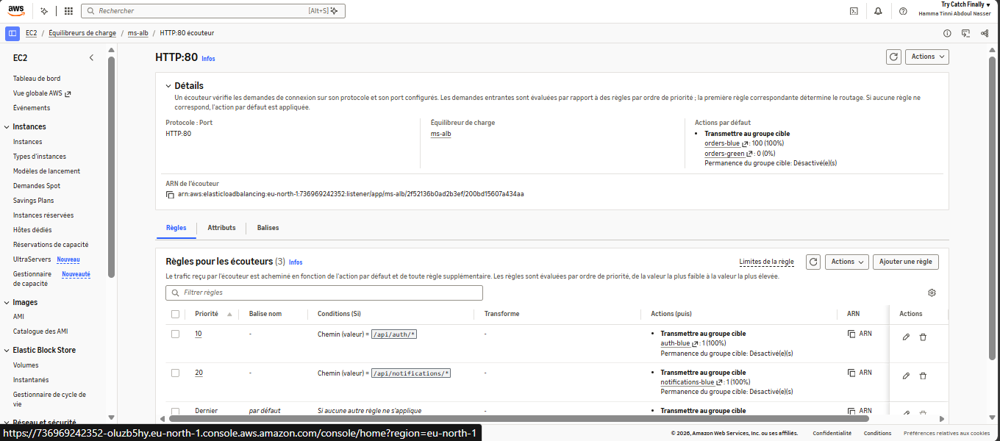 |
| **Target group** – registered Fargate task is healthy | 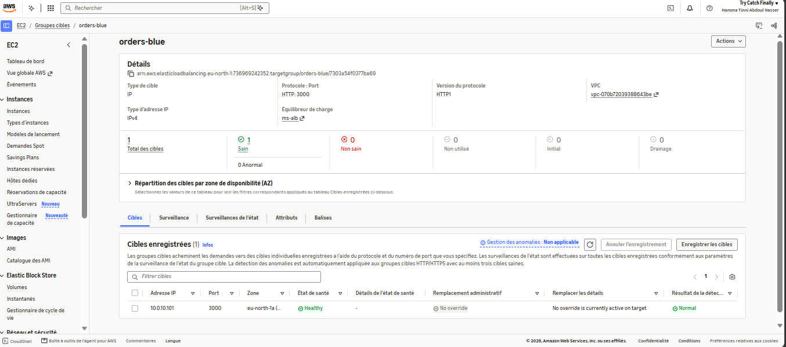 |
| **ECS cluster** – 3 services running (1/1 tasks) | 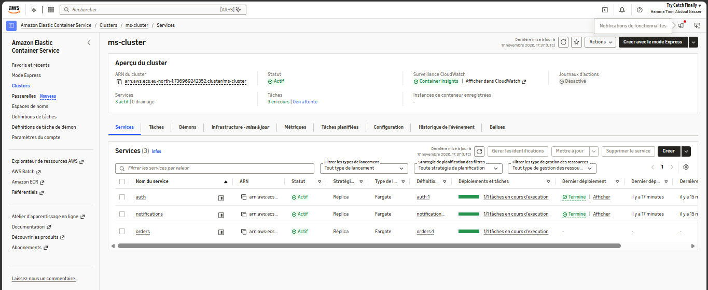 |
| **Task definition (auth)** – `DEMO_PASSWORD` injected from Secrets Manager (`valueFrom`), X-Ray sidecar | 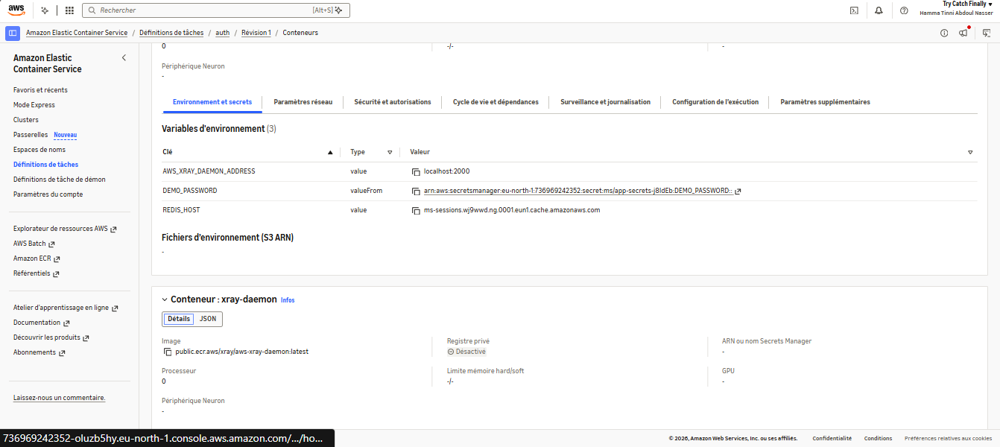 |
| **Cloud Map** – `ecs.local` namespace with the 3 registered services | 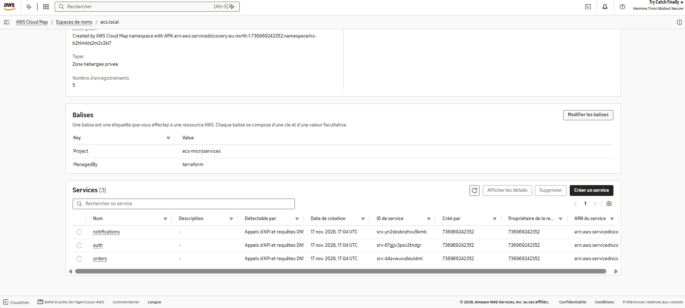 |
| **ECR image scan** – scan on push completed | 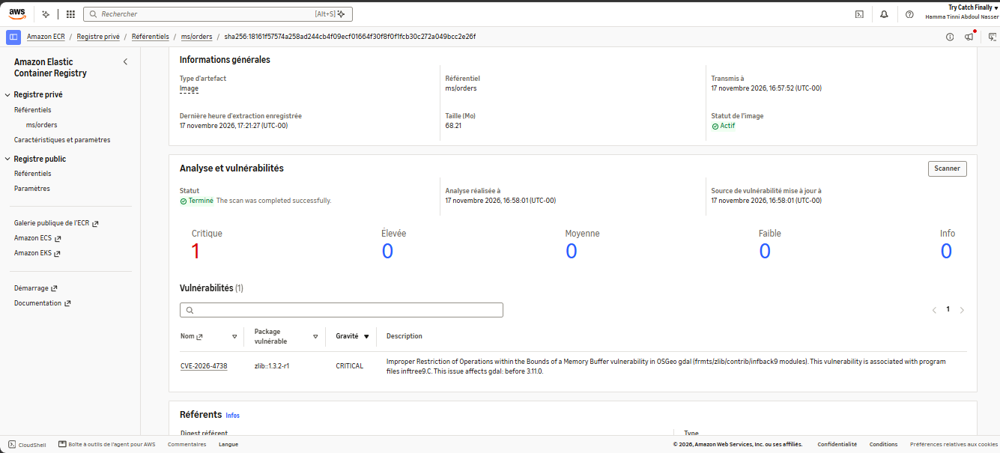 |
| **Secrets Manager** – secret stored, value never exposed to the code | 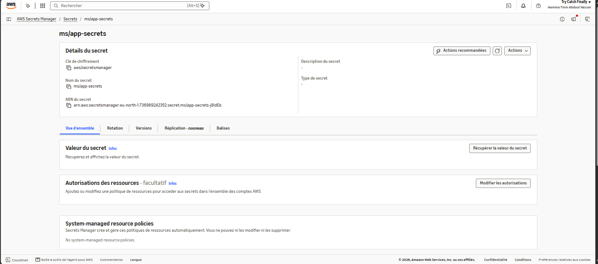 |
| **ElastiCache Redis** – shared session store available | 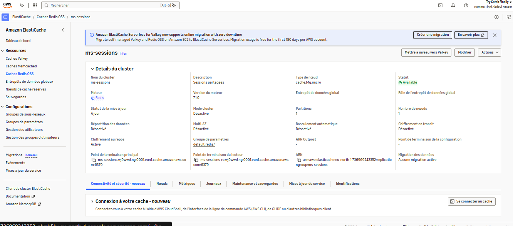 |
| **X-Ray trace map** – Orders calling Auth and Notifications | 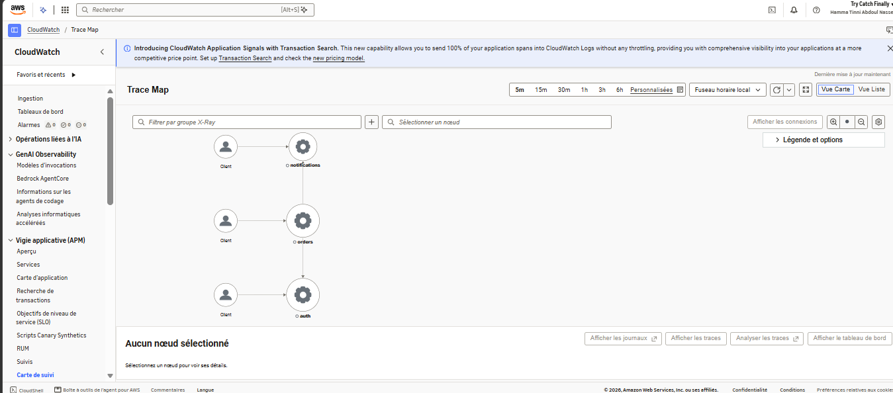 |
| **End-to-end test** – health, login with the secret, create and list orders through the ALB | 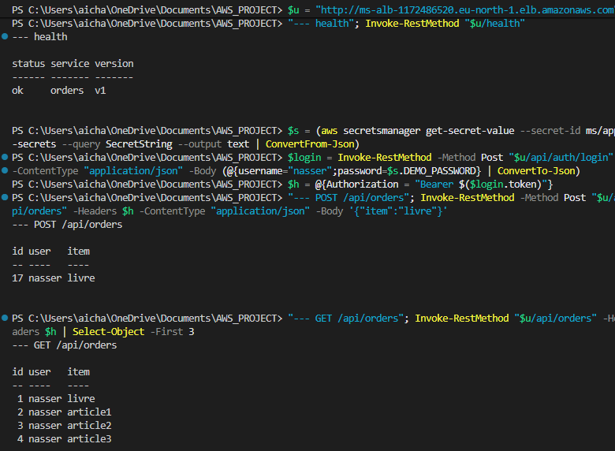 |

## Design decisions

- **Private subnets** for containers and Redis; the ALB and NAT Gateway are the only public components.
- **Two distinct IAM roles**: the *execution role* (used by ECS to pull images, write logs and read secrets) and the *task role* (used by the application code, here only to send X-Ray traces).
- **Terraform `for_each` over one service map**, so the three services share one definition and differ only by path, priority and secrets.
- **Rolling updates with automatic rollback** (ECS deployment circuit breaker) for the services. Blue/green is the planned next step (see below).
- **Lab-sized settings** to limit cost: 1 task per service (production: 2, one per AZ), a single Redis node (production: 2 with Multi-AZ failover), a single NAT Gateway (production: one per AZ), Redis without in-transit encryption (production: TLS enabled).

## What was validated

Deployed and tested on AWS: VPC networking, ALB path routing and health checks, Fargate services, Cloud Map DNS discovery between Orders and Auth/Notifications, Secrets Manager injection, shared sessions through Redis, X-Ray service map, ECR scan on push.

**Finding:** the ECR scan reported one critical CVE in the `zlib` package of the Alpine base image. In production the base image would be updated and the pipeline would fail on critical findings.

## Next perspectives

- **CI/CD with CodePipeline, CodeBuild and CodeDeploy.** The specifications are already in the repository (`pipeline/`, `terraform/cicd.tf`, disabled by default with `create_pipeline=false`) but no pipeline run has been executed yet. Planned flow: GitHub push → CodeBuild (docker build, push to ECR) → CodeDeploy blue/green for Orders (two target groups, test listener on :8080, canary 10 % then 100 %, automatic rollback). To try it: push the repository to GitHub, then `terraform apply -var create_pipeline=true -var github_repo=<user>/<repo>` and authorize the connection in *Developer Tools → Connections*.
- **Blue/green limitation to solve:** CodeDeploy shifts the listener's *default action*, so Orders would stay the ALB default route while Auth and Notifications keep path rules; a dedicated listener or ALB per service would remove this constraint.
- **Production hardening:** HTTPS with ACM, AWS WAF in front of the ALB, ECS service auto scaling, one task per AZ, Multi-AZ Redis with TLS, one NAT Gateway per AZ or VPC endpoints.
- **Real persistence and decoupling:** RDS or DynamoDB for Orders instead of in-memory data, and SQS/SNS between Orders and Notifications.

## Cost

The full stack costs roughly **$0.20 per hour** while running (NAT Gateway, ALB, Redis, Fargate). The lab ran for under two hours and was destroyed right after the evidence was collected (approximately $0.50 of credits).

## Notes

- On the initial free-plan account, EC2, ECS, ECR and other services were denied by an organization policy. The account was upgraded to a paid plan, with a monthly spend limit and a budget alert, after which the deployment worked.
- The project was deployed in `eu-north-1` (Stockholm); change `region` in `terraform/variables.tf` to use another region.
